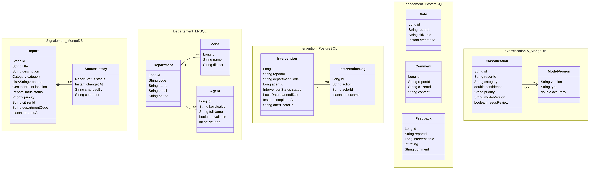
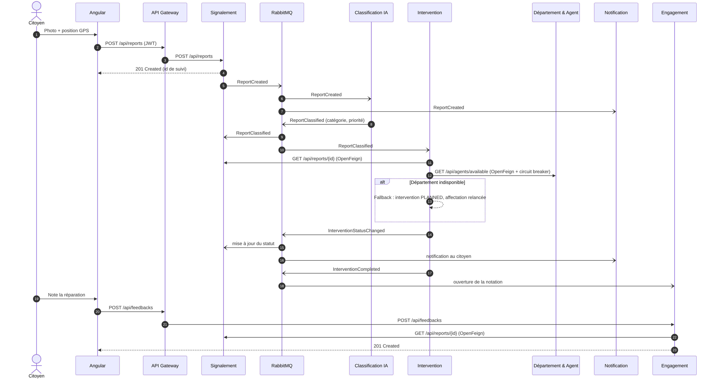
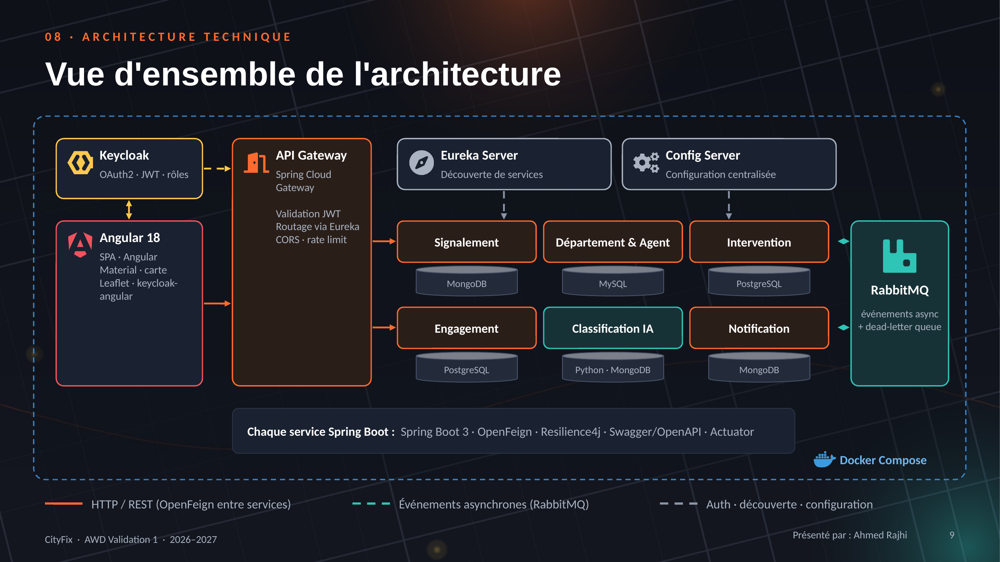

# CityFix : dossier de conception (Validation 1)

Module AWD · Mini-projet · 2026–2027
Équipe : Youssef Laaradh · Bechir Hammoudi · Oussema Seghir · Ahmed Rajhi · Rayen Sabri

---

## 1. Description du sujet

### Problème

Les problèmes urbains (nids-de-poule, éclairage en panne, déchets, fuites d'eau, espaces verts dégradés) sont aujourd'hui signalés par téléphone ou sur papier :

- **Signalements perdus :** aucun numéro de suivi ni historique.
- **Mauvais service :** le routage manuel renvoie les problèmes d'une équipe à l'autre.
- **Aucune visibilité :** le citoyen ne sait jamais si son problème a été résolu.
- **Aucune priorisation :** un problème dangereux attend derrière une plainte mineure.

### Solution

CityFix est une plateforme web qui suit chaque problème du signalement à la résolution :

1. **Signaler :** le citoyen envoie une photo, et la position GPS est ajoutée automatiquement.
2. **Classer :** une IA détecte la catégorie et la priorité, puis oriente vers le bon département.
3. **Intervenir :** un agent disponible est affecté et met à jour l'avancement.
4. **Notifier :** le citoyen est informé à chaque changement de statut.
5. **Évaluer :** le citoyen note la réparation, et les votes des citoyens augmentent la priorité.

### Périmètre (MVP)

| Dans le périmètre | Hors périmètre |
|---|---|
| Application web Angular | Application mobile native |
| 5 catégories : voirie, éclairage, déchets, eau, espaces verts | Paiements en ligne |
| Une seule ville | Multi-villes |

---

## 2. Acteurs et fonctionnalités

| Acteur | User stories |
|---|---|
| **Citoyen** | Signaler un problème avec photo et position GPS · Suivre le statut de mes signalements · Voter et commenter les problèmes proches · Évaluer l'intervention une fois terminée |
| **Agent municipal** | Voir les interventions qui me sont affectées · Mettre à jour le statut (en cours → terminé) · Ajouter une photo « après » comme preuve |
| **Administrateur (mairie)** | Gérer départements, zones et agents · Vérifier les routages IA peu fiables · Suivre les problèmes par zone et département |

L'authentification et les rôles (`CITIZEN`, `AGENT`, `ADMIN`) sont gérés par **Keycloak** (OAuth2 / JWT).

---

## 3. Découpage en microservices

Un microservice par **capacité métier** (contexte borné). Il n'y a pas de découpage par table ou par écran, ni de chevauchement de responsabilités.

| # | Microservice | Responsable | Responsabilité | Entités possédées |
|---|---|---|---|---|
| 1 | Signalement (`report-service`) | Youssef Laaradh | Reçoit les signalements (photos, position) et gère leur cycle de vie | Report, StatusHistory |
| 2 | Département & Agent (`department-service`) | Bechir Hammoudi | Gère départements, zones d'intervention et disponibilité des agents | Department, Zone, Agent |
| 3 | Intervention (`intervention-service`) | Oussema Seghir | Planifie, affecte et suit le travail terrain jusqu'à la résolution | Intervention, InterventionLog |
| 4 | Engagement citoyen (`engagement-service`) | Ahmed Rajhi | Collecte votes, commentaires et notes de satisfaction | Vote, Comment, Feedback |
| 5 | **Classification IA** (`ai-classification-service`), technologie avancée | Rayen Sabri | Détecte la catégorie et la priorité à partir du texte et de la photo (Python FastAPI + ML) | Classification, ModelVersion |
| 6 | Notification (`notification-service`) | Équipe (Rayen Sabri) | Envoie e-mails et alertes in-app en réaction aux événements | Notification |

**Infrastructure :**

| Composant | Responsable |
|---|---|
| `eureka-server` | Youssef |
| `config-server` | Bechir |
| `api-gateway` | Oussema |
| `Frontend/cityfix-web` | Ahmed |

---

## 4. Données de chaque service

**Une base par microservice, aucune base partagée.** Les références entre services se font uniquement par identifiant (ex. `reportId`).

| Microservice | Base | Justification |
|---|---|---|
| Signalement | MongoDB | Documents flexibles (photos, champs par catégorie) et index `2dsphere` pour les requêtes « problèmes près de moi » |
| Département & Agent | MySQL | Données de référence stables et structurées, relations claires (département → zones → agents) |
| Intervention | PostgreSQL | Workflow transactionnel : transitions de statut ACID, affectation cohérente |
| Engagement citoyen | PostgreSQL | Contrainte `UNIQUE(reportId, citizenId)` (un vote par citoyen) et agrégations rapides |
| Classification IA | MongoDB | Prédictions aux métadonnées variables (scores par classe, version du modèle) |
| Notification | MongoDB | Journal de messages en ajout seul, fort volume, sans relations |

---

## 5. Interactions entre services

**Règle :**

- Si l'appelant a besoin du résultat pour continuer, l'appel est **synchrone** : OpenFeign, protégé par un circuit breaker Resilience4j.
- Si les autres services doivent seulement réagir, on publie un **événement asynchrone** RabbitMQ sur le topic exchange `cityfix.events`.

### Synchrone (OpenFeign)

| Appelant → Appelé | Données échangées | Pourquoi synchrone | Si l'appelé est indisponible |
|---|---|---|---|
| Intervention → Signalement | `GET /api/reports/{id}` : position, description | Nécessaire pour planifier | Circuit breaker : l'intervention reste `PLANNED`, nouvelle tentative plus tard |
| Intervention → Département | `GET /api/agents/available?dept&zone` | Il faut un agent pour affecter | Fallback : intervention `UNASSIGNED`, affectation relancée |
| Engagement → Signalement | `GET /api/reports/{id}` : existence et statut | Validation avant vote ou note | Réponse 503 avec message de réessai, rien n'est stocké |
| Angular → Classification IA (via Gateway) | `POST /api/ai/classify` | Suggestion en direct pendant la saisie | Le citoyen choisit la catégorie manuellement |

### Asynchrone (RabbitMQ)

| Événement | Producteur | Consommateurs | Contenu |
|---|---|---|---|
| `ReportCreated` | Signalement | Classification IA, Notification | reportId, texte, photos, position |
| `ReportClassified` | Classification IA | Signalement, Intervention | reportId, catégorie, priorité, departmentCode, confiance |
| `InterventionStatusChanged` | Intervention | Signalement, Notification, Département | interventionId, reportId, agentId, statut |
| `InterventionCompleted` | Intervention | Engagement, Notification | interventionId, reportId |
| `PriorityBoosted` | Engagement | Signalement | reportId, nombre de votes |

Les files sont **durables**. Un service arrêté retrouve ses messages à son redémarrage. Après 3 échecs, un message part dans une **dead-letter queue**.

---

## 6. API REST prévues

| Microservice | Méthode | URI | Codes |
|---|---|---|---|
| Signalement | POST | `/api/reports` | 201, 400 |
| | GET | `/api/reports/{id}` | 200, 404 |
| | GET | `/api/reports?status&category&near` | 200 |
| | GET | `/api/reports/me` | 200, 401 |
| | PATCH | `/api/reports/{id}/status` | 200, 404, 409 |
| | DELETE | `/api/reports/{id}` | 204, 403, 404 |
| Département & Agent | GET | `/api/departments` | 200 |
| | POST | `/api/departments` | 201, 400, 409 |
| | GET | `/api/departments/{code}/agents` | 200, 404 |
| | GET | `/api/agents/available?dept&zone` | 200, 404 |
| | POST | `/api/agents` | 201, 400 |
| | PATCH | `/api/agents/{id}/availability` | 200, 404 |
| Intervention | POST | `/api/interventions` | 201, 400, 404 |
| | GET | `/api/interventions/{id}` | 200, 404 |
| | GET | `/api/interventions?agentId&status` | 200 |
| | PUT | `/api/interventions/{id}/assign` | 200, 404, 409 |
| | PATCH | `/api/interventions/{id}/status` | 200, 409 |
| | GET | `/api/interventions/{id}/logs` | 200, 404 |
| Engagement citoyen | POST | `/api/votes` | 201, 404, 409 |
| | DELETE | `/api/votes/{reportId}` | 204, 404 |
| | GET | `/api/engagement/{reportId}` | 200 |
| | POST | `/api/comments` | 201, 400 |
| | POST | `/api/feedbacks` | 201, 409, 422 |
| | GET | `/api/feedbacks/stats?dept` | 200 |
| Classification IA | POST | `/api/ai/classify` | 200, 422 |
| | GET | `/api/ai/classifications/{reportId}` | 200, 404 |
| | GET | `/api/ai/review-queue` | 200 |
| | PUT | `/api/ai/classifications/{reportId}` | 200, 404 |
| | GET | `/api/ai/models/current` | 200 |
| | GET | `/api/ai/health` | 200 |
| Notification | GET | `/api/notifications/me` | 200 |
| | PATCH | `/api/notifications/{id}/read` | 204, 404 |

---

## 7. Architecture technique

**Stack imposée :**

| Rôle | Choix |
|---|---|
| Front-end | Angular |
| Point d'entrée | API Gateway (Spring Cloud Gateway) |
| Découverte de services | Eureka |
| Configuration | Config Server |
| Sécurité | Keycloak |
| Microservices | Spring Boot 3, plus Python FastAPI pour le MS5 |
| Bases de données | MySQL, PostgreSQL, MongoDB |
| Messagerie | RabbitMQ |
| Déploiement | Docker Compose |

**Résilience :**

- Resilience4j sur chaque client OpenFeign : circuit breaker, retry avec backoff, fallback.
- Files RabbitMQ durables avec dead-letter queue.
