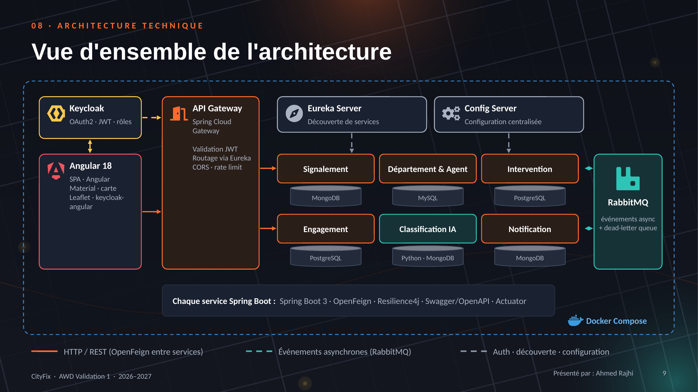

# CityFix

> **Signalez. Suivez. C'est réparé.**
> Plateforme intelligente de signalement des problèmes urbains, basée sur une architecture microservices Spring Boot.
> Module AWD · Mini-projet · Année universitaire 2026–2027

## Sujet

Aujourd'hui, un citoyen qui signale un nid-de-poule, un lampadaire en panne ou un dépôt sauvage appelle la mairie. Le problème est noté sur papier, transmis au mauvais service, et le citoyen n'a jamais de retour.

**CityFix** boucle le cycle : le citoyen envoie une photo géolocalisée, une IA classe le problème et l'oriente vers le bon département, un agent est affecté, le citoyen est notifié à chaque étape puis note la réparation.

**Acteurs :** Citoyen · Agent municipal · Administrateur (mairie)

## Équipe

| Membre | Microservice(s) | Base de données |
|---|---|---|
| Youssef Laaradh | `report-service` (Signalement) · `eureka-server` | MongoDB |
| Bechir Hammoudi | `department-service` (Département & Agent) · `config-server` | MySQL |
| Oussema Seghir | `intervention-service` (Intervention) · `api-gateway` | PostgreSQL |
| Ahmed Rajhi | `engagement-service` (Engagement citoyen) · `Frontend/cityfix-web` | PostgreSQL |
| Rayen Sabri | `ai-classification-service` (MS5, technologie avancée : Python FastAPI + IA) · `notification-service` | MongoDB |

## Architecture



| Composant | Technologie | Port |
|---|---|---|
| Front-end | Angular 18 | 4200 |
| API Gateway | Spring Cloud Gateway | 8080 |
| Eureka Server | Spring Cloud Netflix Eureka | 8761 |
| Config Server | Spring Cloud Config (profil native) | 8888 |
| Keycloak | OAuth2 / JWT | 8180 |
| report-service | Spring Boot 3 + MongoDB | 8081 |
| department-service | Spring Boot 3 + MySQL | 8082 |
| intervention-service | Spring Boot 3 + PostgreSQL + OpenFeign + Resilience4j | 8083 |
| engagement-service | Spring Boot 3 + PostgreSQL + OpenFeign + Resilience4j | 8084 |
| ai-classification-service | Python FastAPI + MongoDB | 8085 |
| notification-service | Spring Boot 3 + MongoDB + RabbitMQ | 8086 |
| RabbitMQ | exchange `cityfix.events` | 5672 / 15672 |

**Communication :**

- **Synchrone (OpenFeign + Resilience4j)** quand l'appelant a besoin de la réponse pour continuer :
  - Intervention → Signalement
  - Intervention → Département
  - Engagement → Signalement
- **Asynchrone (RabbitMQ)** quand les autres services doivent seulement réagir :
  - `ReportCreated`
  - `ReportClassified`
  - `InterventionStatusChanged`
  - `InterventionCompleted`
  - `PriorityBoosted`

Le détail de la conception (acteurs, découpage, données, interactions, API REST) se trouve dans [Documentation/CityFix_Dossier.md](Documentation/CityFix_Dossier.md).

## Structure du dépôt

```
CityFix/
├── Backend/            un projet par microservice
├── Frontend/           application Angular
├── Documentation/
│   ├── Presentation/   support de présentation
│   └── Diagrams/       diagrammes d'architecture, de séquence et de données
├── docker-compose.yml
└── README.md
```

## Lancement

**Prérequis :** Java 17+, Maven 3.9+, Node 20+, Python 3.11+, Docker.

1. Démarrer l'infrastructure (bases de données, RabbitMQ, Keycloak, MailHog) :

   ```bash
   docker compose up -d
   ```

2. Démarrer les services dans cet ordre (un terminal par service) :

   ```bash
   cd Backend/eureka-server && mvn spring-boot:run      # http://localhost:8761
   cd Backend/config-server && mvn spring-boot:run      # http://localhost:8888
   cd Backend/api-gateway && mvn spring-boot:run        # http://localhost:8080
   cd Backend/report-service && mvn spring-boot:run     # puis les autres microservices
   ```

3. Démarrer le service IA :

   ```bash
   cd Backend/ai-classification-service
   pip install -r requirements.txt
   uvicorn app.main:app --port 8085
   ```

4. Démarrer le front-end :

   ```bash
   cd Frontend/cityfix-web && npm install && npm start  # http://localhost:4200
   ```

Tous les services s'enregistrent dans Eureka (http://localhost:8761). Chaque service Spring expose `/actuator/health`. La documentation Swagger de chaque microservice métier est sur `/swagger-ui.html`.

Pour tout lancer dans Docker (après `mvn package` dans chaque projet Spring) : `docker compose --profile apps up -d --build`.

## Gestion de projet

- Tableau des tâches : *lien Jira / GitHub Projects à ajouter*
- Branches : `main` ← `develop` ← `feature/<service>-<tâche>`, fusion par pull request relue
- Commits : [Conventional Commits](https://www.conventionalcommits.org/fr/) (`feat(report): ...`, `fix(gateway): ...`, `docs: ...`)
